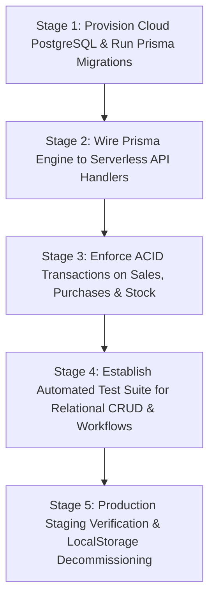

# SoleControl — Evidence-Based Remediation & Recovery Plan
**Date:** 25 November 2026  
**Status:** Strategic Plan Approved for Execution  
**Authors:** Senior Software Architect & Engineering Lead  

---

## 1. Executive Strategy

Remediation must not consist of cosmetic UI tweaks or more `localStorage` patches. The goal is to connect the application to a **real, centralized PostgreSQL database** so that all 24 modules read and write to one authoritative source of truth.

---

## 2. What Can Be Preserved, What Must Be Corrected, What Should Not Be Touched

### A. What Can Be Preserved (Keep Intact)
- **Frontend UI & Components (`apps/web`)**: All 24 pages, layouts, navigation shell, command palette, themes, icons, typography, and styling. The UI represents hundreds of hours of high-quality design and conforms to modern SaaS standards.
- **Prisma Schema (`prisma/schema.prisma`)**: The 426-line relational model with 30+ tables (Users, Stores, Products, Variants, Stock Balances, Stock Movements, Purchases, Sales, Journals, Accounts, GST) is comprehensive and correctly designed.
- **Shared Contracts (`packages/shared`)**: Zod validation schemas, permission keys, and enums.

### B. What Must Be Corrected (Refactor / Replace)
- **Database Connection**: Connect production to a managed PostgreSQL database (e.g. Neon Serverless Postgres, Supabase, or AWS RDS).
- **Backend Unification**: Replace `api/index.js` (which uses in-memory `mockData.js`) by configuring Prisma to connect to the managed PostgreSQL database using Prisma's serverless driver adapter (`@prisma/adapter-pg` or `@neondatabase/serverless`).
- **Sales Inventory Decrement**: Implement atomic stock balance deduction when sales invoices are posted.
- **Client Storage Retirement**: Progressively retire the `localStorage` engines in `apps/web/src/lib/storage.ts` once real PostgreSQL persistence is active.

### C. What Should Not Be Touched
- Do NOT touch working UI flows (Purchase split bill view, Size x Colour matrix, Barcode designer preview).
- Do NOT introduce additional role-based workspaces (Super Admin scope is strictly maintained).
- Do NOT rewrite or replace the technology stack (React 18 + Vite + Tailwind + Radix + Node + Express + Prisma + PostgreSQL).

---

## 3. Prioritized 5-Stage Recovery Sequence

### Stage 1: Database Provisioning (Prerequisite for All Persistence)
- Provision a PostgreSQL database instance (Neon Serverless Postgres or Supabase).
- Set `DATABASE_URL` in environment secrets (`.env` and Vercel Project Environment Variables).
- Execute `npx prisma migrate deploy` to create all 30+ relational tables with foreign keys and indexes.
- Run `npx prisma db seed` to establish system constants (Store 1, Financial Year 2026-27, System Permissions, Chart of Accounts).

### Stage 2: Serverless Prisma Integration
- Adapt `api/index.js` or compile `apps/api` using Prisma with `@prisma/adapter-pg` / `@neondatabase/serverless` pool so that API endpoints perform real Prisma queries (`prisma.user.findMany()`, `prisma.purchase.create()`, `prisma.stockBalance.upsert()`).
- Verify that every CRUD endpoint writes to PostgreSQL and returns persisted database records.

### Stage 3: Workflow Integrity & ACID Transactions
- Ensure `POST /purchases` runs a single database transaction:
  1. Insert purchase header and items.
  2. Upsert `stock_balances` and insert `stock_movements`.
  3. Create vendor credit balance.
  4. Post balanced double-entry journal entry.
- Ensure `POST /sales` runs a transaction:
  1. Insert sale header and items.
  2. Decrement `stock_balances` and insert negative `stock_movements`.
  3. Record GST outward tax liability.
  4. Post sales and COGS journal entries.

### Stage 4: Comprehensive Test Suite
- Expand `apps/api/src/server.test.ts` into a robust test suite covering:
  - Auth & RBAC permission checks
  - Purchase inwarding and landed cost calculation
  - Sales invoice creation and inventory depletion
  - Trial balance debit/credit equality
  - Master data CRUD and foreign key cascades

### Stage 5: Production Staging & Verification
- Deploy to Vercel with real `DATABASE_URL`.
- Perform a live verification test:
  1. Create a supplier and inward a purchase bill on Computer A.
  2. Open an incognito window / Computer B, verify the new stock appears.
  3. Record a sale for that SKU, verify stock decrements on both screens.
  4. Verify Trial Balance and GST registers reflect the transactions.
