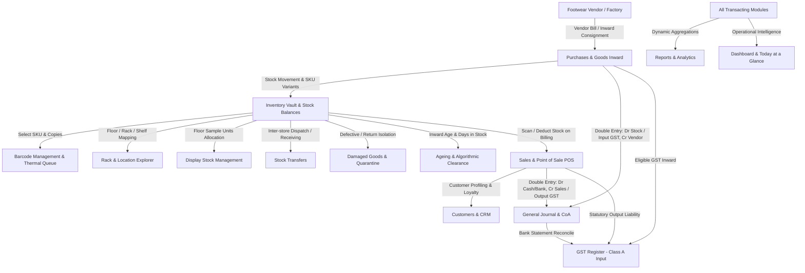

# SoleControl — End-to-End Footwear Retail Workflow Dependency Map

## Executive Summary
SoleControl operates as a unified footwear retail operating system where transactions propagate with mathematical integrity across procurement, inventory, barcoding, POS sales, accounting, and compliance.

## Detailed Module-by-Module Interaction Verification

### 1. Purchase → Inventory & Master Data
- **Trigger**: New Purchase Bill submission (Status: `FINAL`).
- **Data Flow**:
  1. Validates or registers footwear supplier.
  2. Resolves or automatically creates Article & Product Variant records (`SKU`, `mrp`, `cost_price`, `selling_price`, `size`, `colour`).
  3. Increments store inventory balance (`stock_balances`) at root default location (`FLOOR_1`).
  4. Records immutable entry in `stock_movements` with type `PURCHASE_RECEIPT`.

### 2. Purchase → Financial Accounting & Statutory GST
- **Trigger**: Finalised purchase.
- **Data Flow**:
  1. Creates balanced multi-line general journal:
     - `Debit`: Inventory Asset (Account: 1040)
     - `Debit`: GST Input Tax Credit (Account: 1050) [Class A purchases only]
     - `Credit`: Accounts Payable / Vendor Liability (Account: 2010)
  2. For Class A purchases, populates `gst_transactions` as `INPUT` tax credit.
  3. Class B purchases (cash market / informal) are tracked as inventory cost without claiming GST input tax credit.

### 3. Inventory → Barcode Management
- **Trigger**: New stock received or tag reprint requested.
- **Data Flow**:
  1. Barcode module reads available product variants directly from `DB.balances`.
  2. Displays genuine SKU, model name, size, colour, and selling MRP.
  3. Prevents phantom label printing by disallowing queueing when no stock variants exist.

### 4. Inventory → Ageing & Clearance Recommendations
- **Trigger**: Periodic daily valuation or clearance rule assessment.
- **Data Flow**:
  1. Calculates exact age: `Math.floor((Date.now() - inwardDate) / 86400000)`.
  2. Dynamically groups active inventory into standard retail aging buckets:
     - Fresh Stock: 0–30 Days
     - Regular Stock: 31–60 Days
     - Slow-Moving: 61–90 Days
     - At-Risk Aged: 91–180 Days
     - Critical Dead Stock: 180+ Days
  3. When an aging rule threshold is crossed, generates automated clearance discount suggestions (e.g., 20%–30% promotional markdown).

### 5. Sales & POS → Inventory, CRM & Financial Ledgers
- **Trigger**: Invoice checkout at POS.
- **Data Flow**:
  1. Decrements available inventory in `stock_balances`.
  2. Appends `SALE_DISPATCH` movement in `stock_movements`.
  3. Updates customer purchase history and loyalty tier.
  4. Creates balanced sales journal entry:
     - `Debit`: Cash / Bank / Customer Receivable
     - `Credit`: Sales Revenue (Account: 4010)
     - `Credit`: GST Output Liability (Account: 2020)
     - `Debit`: Cost of Goods Sold (Account: 5010)
     - `Credit`: Inventory Asset (Account: 1040)

### 6. Damaged Goods & Quarantine
- **Trigger**: Defective return or store damage logging.
- **Data Flow**:
  1. Segregates damaged footwear out of saleable inventory.
  2. Moves stock to defective quarantine without inflating available shelf count.
  3. On write-off, posts general journal: `Dr Loss on Damaged Goods`, `Cr Inventory Asset`.

### 7. Bank & GST Compliance Reconciliation
- **Trigger**: Monthly GSTR return filing and bank statement import.
- **Data Flow**:
  1. Matches bank statement deposit lines against recorded POS card/UPI receipts.
  2. Reconciles net GST payable = `Output GST Liability` minus `Eligible Input GST Credit`.
